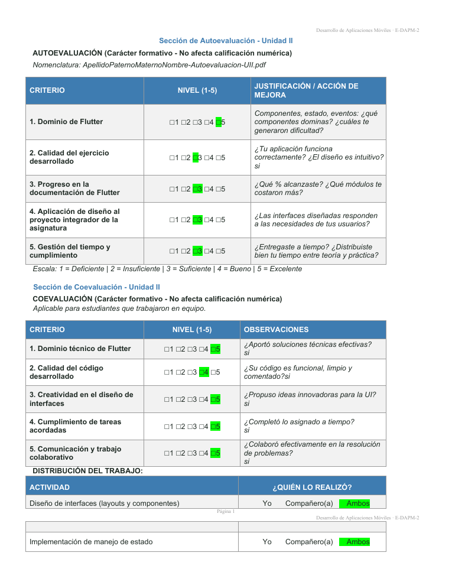

# Autoevaluación y Coevaluación · Unidad II

Autoevaluación y coevaluación de la **Unidad II** de Desarrollo de Aplicaciones Móviles (E-DAPM-2). Es de carácter formativo y no afecta la calificación numérica.

| | |
|---|---|
| **Equipo** | Cristopher Gerardo Villanueva Ramírez · Ángel Gerardo Méndez Cervantes |
| **Materia** | Desarrollo de Aplicaciones Móviles |
| **Documento** | [`VillanuevaRamirezCristopheryAngelAutoevaluacionUII.pdf`](VillanuevaRamirezCristopheryAngelAutoevaluacionUII.pdf) |

## Contenido

- **Autoevaluación:** dominio de Flutter, calidad del ejercicio, progreso en la documentación, diseño aplicado al proyecto integrador y gestión del tiempo (escala del 1 al 5).
- **Coevaluación:** dominio técnico, calidad del código, creatividad en la interfaz, cumplimiento y trabajo colaborativo del compañero.
- **Distribución del trabajo:** quién realizó el diseño de interfaces, el manejo de estado, los eventos, las pruebas y la documentación.

## Documento

<table>
  <tr><td align="center"> Página 1</td><td align="center"> Página 2</td></tr>
</table>
